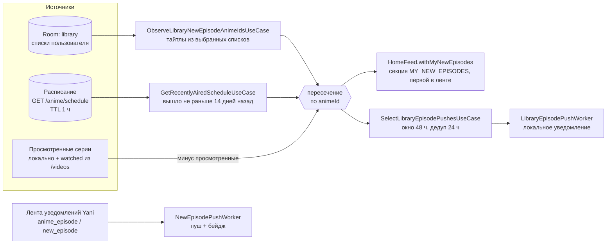

# Новые серии из ваших списков

Блок «Новые серии» на главной и локальные пуши о выходе серий. Отдельной серверной функции нет: всё
считается на клиенте из расписания Yani и локальной библиотеки. `YummyTV_API` в этом не участвует.

## Схема

## Источники

- **Списки пользователя.** Подтягиваются из Yani в Room (`library`) при входе, синк запускает
  `MainSideEffectsHandler.syncLibrary`. Какие списки считаются, задаёт enum `NewEpisodesSource`
  (`core/model`): `WATCHING`, `PLANNED`, `COMPLETED`, `POSTPONED`, `DROPPED`, `FAVORITES`. По умолчанию
  включены `WATCHING` и `FAVORITES`. Сопоставление — `LibraryItem.matches` (`NewEpisodesSourceUtils`).
- **Расписание.** `GET /anime/schedule`, `YaniScheduleRepository` через `offlineFirstCache`, TTL 1 час
  (см. [storage-and-cache.md](storage-and-cache.md)).
- **Просмотренные.** `ObserveWatchedEpisodesUseCase` объединяет локальные отметки и серверный `watched`
  из кэша `/videos` (см. [watch-progress.md](watch-progress.md)).

## Как определяется «новая серия»

Формула: недавно вышедшие по расписанию ∩ тайтлы из выбранных списков − уже просмотренные.

- `GetRecentlyAiredScheduleUseCase` оставляет тайтлы, у которых последняя серия вышла не раньше 14 дней
  назад (`RECENT_WINDOW_SECONDS`), сортирует от свежих к старым, убирает дубли по `animeId`. Номер серии
  берётся из `aired`.
- Дату последней серии считает `AnimeScheduleItem.lastAiredSeconds` (`HomeScheduleUtils`). У анонсов
  `prev_date` — общая заглушка, поэтому дата берётся только при `aired > 0`. Из `prev_date` и `next_date`
  выбирается максимум в диапазоне `1..now`: прошедший `next_date` тоже считается выходом.
  Подробнее про странности — [yani-api.md](yani-api.md).
- `HomeFeed.withMyNewEpisodes` (`HomeViewModelUtils`) фильтрует по id из библиотеки, убирает просмотренные и
  ставит секцию `MY_NEW_EPISODES` первой. Блок включается `HomeBlockKind.MY_NEW_EPISODES`; расписание
  перечитывается при старте, возврате на экран и pull-to-refresh.

### `next_episode` — другое

Плоское поле `next_episode` из списков Yani кладётся в `nextEpisodeAtSeconds` (значения ≤ 0 отбрасываются,
пустой ответ не затирает старое значение). Оно нужно только для обратного отсчёта (`ReleaseCountdownText`)
и сортировки `LibrarySort.NEXT_EPISODE`. Блок на главной и пуши его не читают.

## Пуши

Оба воркера периодические: интервал 3 часа, `NetworkType.CONNECTED`, экспоненциальный backoff от 30 минут.
Старт — `BackgroundWorkStarter`, планирование — `NewEpisodePushScheduler`.

| Воркер | Когда ставится | Источник | Что делает |
|---|---|---|---|
| `LibraryEpisodePushWorker` | всегда | та же формула, что и блок на главной | локальный пуш |
| `NewEpisodePushWorker` | только с авторизацией | лента уведомлений Yani (`type == "anime_episode"`, `subType == "new_episode"`, лимит 30) | пуш и бейдж непрочитанных |

Правила `SelectLibraryEpisodePushesUseCase` (чистая функция без сети):

- Первый прогон только записывает baseline и ничего не показывает: бэклог не прилетает.
- Пуш получает серия, вышедшая не позже 48 часов назад (`FRESH_WINDOW_SECONDS`), которую не смотрели,
  о которой не уведомляли (ключ `animeId:ep`, `LibraryEpisodePushKeys`) и по тайтлу которой не было
  пуша за 24 часа (`DEDUP_WINDOW_SECONDS`). Дедуп общий с `NewEpisodePushWorker` (`recentPushes`).
- Известные ключи записываются всегда, даже если пуши выключены или нет разрешения, иначе при включении
  придёт накопившееся.
- Показ — `NewEpisodePushNotificationService`, гейт — `episodePushSettingsStore.libraryEnabled` и
  `areNotificationsEnabled()`.
- Бейдж: `NewEpisodePushWorker` пишет число непрочитанных, `MainViewModel` показывает его в меню; также
  обновляется при входе (`refreshUnreadNotifications`).

## Без сети

- Работает из локальных данных: расписание из Room-кэша (пока есть), библиотека, отсчёт, отметки просмотра.
- Не работает: обновление расписания после истечения TTL (по правилам `offlineFirstCache` при ошибке
  отдаётся устаревший кэш) и оба воркера (нужна сеть, при ошибке `Result.retry()`).
- Общая картина по офлайну — [offline.md](offline.md).
