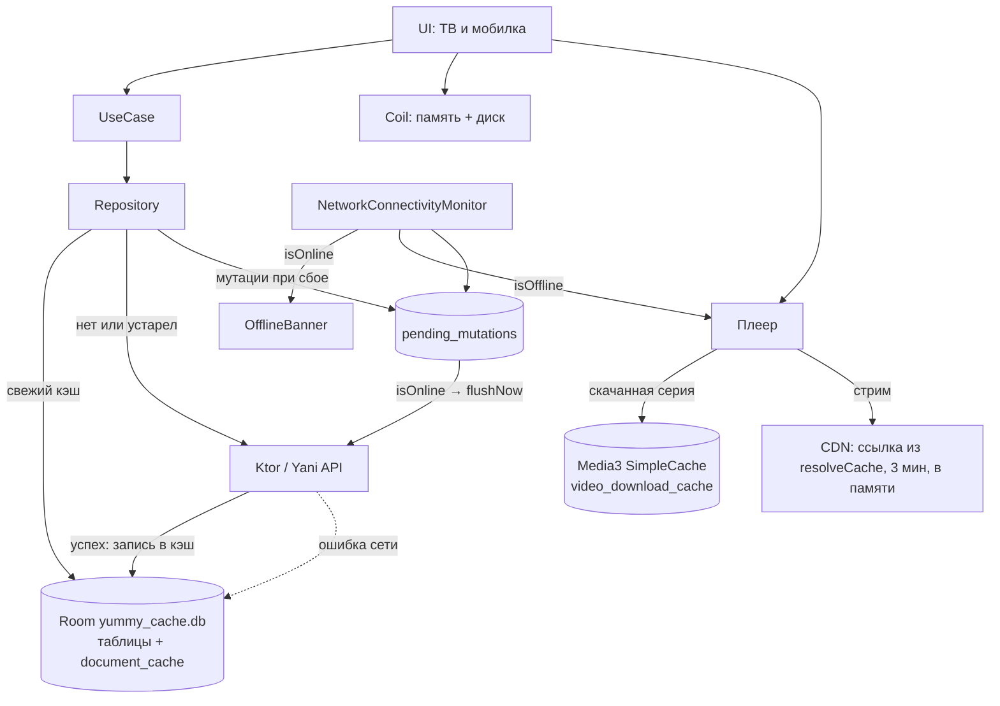

# Поведение без сети и при нестабильной связи

Сводка по всем слоям (данные, очередь, плеер, загрузки) и как это проверять на устройстве. Детали
каждого слоя — в профильных документах, ссылки ниже.

## Обзор

Данные идут по принципу offline-first: свежий кэш отдаётся сразу, устаревший — только если сеть
не ответила. Пользовательские данные (библиотека, прогресс, загрузки, очередь) живут в Room и кэш-очисткой
не затрагиваются. Детали слоёв: [storage-and-cache.md](storage-and-cache.md),
[continue-watching.md](continue-watching.md), [new-episodes.md](new-episodes.md),
[video-download.md](video-download.md).

## Монитор сети

`NetworkConnectivityMonitor` (`core/network`):

- `isOnline` — есть сеть с `NET_CAPABILITY_VALIDATED`. Это не «интернета нет», а «система не смогла его
  проверить»: при VPN, captive portal и заблокированных проверках Google связь может работать при
  `isOnline = false`.
- `isInternetReachable()` — быстрая TCP-проба по IP (`1.1.1.1:443`, `8.8.8.8:443`, по 1,5 с). Без
  сети отказывает сразу. Плеер зовёт её перед ожиданием сети (`awaitOnline`), чтобы не ждать зря.
- `isOffline` — интернета точно нет: сетей нет вовсе («Самолёт») либо сеть есть, но не подтверждена
  системой и проба тоже не прошла. Монитор обновляет его при каждом изменении сетей. На нём держатся
  текст ошибки плеера «нет подключения», автоповтор при возврате связи и откладывание подсказки «Сменить
  плеер»: при VPN и captive portal он остаётся `false`, и несвязанная ошибка не выдаётся за обрыв сети.
- Баннер «Нет сети» (`LocalIsOffline`, `OfflineBanner`) по-прежнему строится от `!isOnline`. В
  репозитории `isOnline` намеренно не передаётся (см. [storage-and-cache.md](storage-and-cache.md)).

## Данные

| Что | Без сети |
|---|---|
| Главная, детали, каталог (первая страница), расписание, профиль, комментарии (чтение) | Отдаётся устаревший кэш (`offlineFirstCache`, `DocumentCacheStorage`), ошибка только без кэша |
| Библиотека, «Смотреть позже», прогресс просмотра | Локальный Room, работает полностью |
| Серверные списки после изменения | Кэш помечается устаревшим (`cachedAt = 0`), а не удаляется: офлайн остаётся последний |
| Личные сообщения, запись комментариев | Только онлайн |
| Кэши старше 7 суток | Чистятся при старте (`StorageCleanup`) |

Баннер «Нет сети» есть на главной, каталоге, деталях и расписании (мобилка), на ТВ — на главной.

Выход из аккаунта и токен: офлайн-сеть сессию не сбрасывает, 401 её тоже не стирает.

## Очередь отложенных мутаций

Оценки, списки, избранное, отметки «просмотрено» и голосования при повторяемом сбое
(`isRetryableMutationFailure`) уходят в `pending_mutations` и дожимаются при появлении сети. Схема, коды
ответов и места, где очередь сбрасывается принудительно, — в [storage-and-cache.md](storage-and-cache.md).
Секунды просмотра уходят вместе с позицией, см. [watch-progress.md](watch-progress.md).

## Плеер

- Обрыв при живом буфере: загрузчик молча ретраит до 20 раз, пользователь его не видит.
- Kodik/CVH: тихий перерезолв ждёт сеть до 30 с (`awaitOnline`), попытки не тратятся.
- Alloha: свежая сессия восстановления тоже ждёт сеть до 30 с перед открытием, иначе все 4 попытки
  сгорали за секунды.
- Когда попытки исчерпаны и сети нет, ошибка говорит про интернет (`player_no_connection`), без
  заголовка «плеер вернул ошибку» и без кнопок смены плеера и озвучки. Кнопка «Повторить» остаётся.
- Как только `isOffline` снова `false`, а ошибка на экране висит, `PlayerViewModel` повторяет
  воспроизведение сам (`observeConnectivityRestore`). Если ошибки нет, ничего не происходит.
- Скачанная серия: ошибка воспроизведения означает повреждённый или неполный кэш (`player_download_corrupted`).
- Подсказка «Сменить плеер» при затянувшемся восстановлении без сети откладывается.

Подробности про буфер и восстановление — в [player-buffering.md](player-buffering.md).

## Загрузки и «Продолжить»

- Загрузки идут через WorkManager (`CONNECTED`, при «только Wi-Fi» `UNMETERED`). Обрыв сети посреди
  загрузки не переводит её в «Ошибка»: временные сбои повторяются, см. [video-download.md](video-download.md).
- Карточка «Продолжить» запускает скачанную копию серии из локального кэша, если озвучка совпала.
  Только на мобилке: на ТВ загрузок нет.

## Как проверять на устройстве

Эмулятор, `adb shell cmd connectivity airplane-mode enable|disable`.

1. Холодный старт в самолёте: главная из кэша с баннером, каталог с кэшем, библиотека целиком.
2. Воспроизведение, затем самолёт на 5–7 минут: сначала спиннер, затем ошибка «нет подключения».
   Вернуть сеть: плеер продолжает сам. Для Alloha в логе (`PlayerViewModel`) видна строка
   `Alloha recovery waits for network`, затем `attempt=1/4`.
3. Загрузка серии и самолёт посреди неё: статус не становится «Ошибка», после возврата сети она
   дозагружается. Затем самолёт и «Продолжить» с главной: серия играет из кэша с сохранённой позиции.
4. Очередь мутаций: положить запись в `pending_mutations` отладочной базы (остановить приложение,
   скопировать `yummy_cache.db` с `-wal` и `-shm`, вставить строку, вернуть), запустить в самолёте,
   затем включить сеть: запись уходит за секунды.
